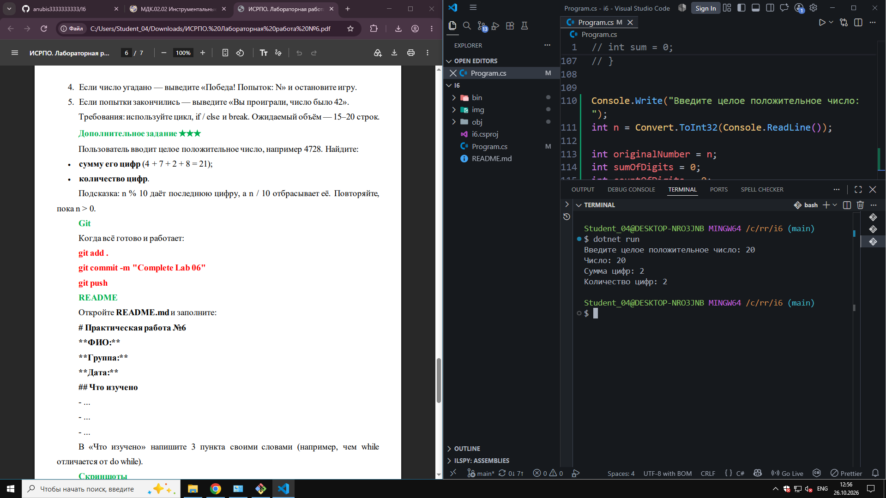
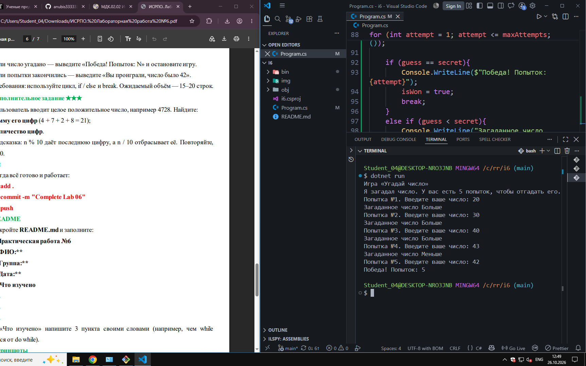

# ISRPO 6

**ФИО:** Чумаченко Михаил
**Группа:** ИСП-242

## Что изучено

- **Цикл `for` и его применение:** Научился использовать цикл `for` для задач, где количество повторений известно заранее (например, вывод чисел в диапазоне или таблица умножения).
- **Различия `while` и `do while`:** Узнал, что цикл `while` проверяет условие до выполнения тела (и может не выполниться ни разу), а `do while` проверяет условие после, поэтому гарантирует хотя бы один обязательный запуск кода.
- **Управление циклами через `break` и `continue`:** Понял, как досрочно выходить из цикла с помощью оператора `break` и как пропускать текущую итерацию (шаг) с помощью оператора `continue`.

## Скриншоты

